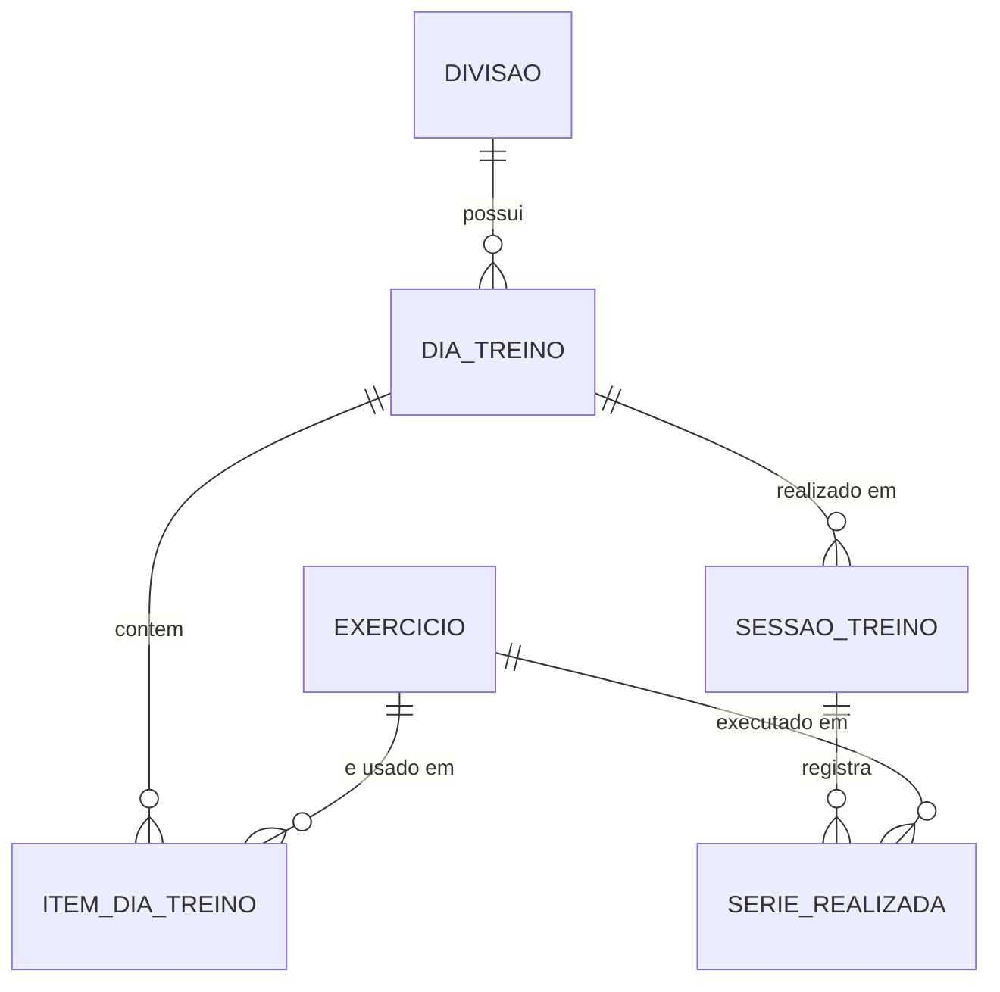

# Gerenciador de Treinos

Aplicação para acompanhamento de treinos de musculação: o usuário monta divisões de treino (ABC, Push/Pull/Legs...), define os exercícios de cada dia da semana, escolhe a divisão ativa e registra a carga de cada série executada, com cronômetro de descanso.

- **Back-end:** API REST em Spring Boot (Java 21)
- **Front-end:** Vue 3 + Vite (`/frontend`)
- **Banco de dados:** PostgreSQL no Supabase, com migrations Flyway
- **Documentação:** Swagger UI (springdoc)

## Video explicativo: https://youtu.be/i0CIVKmfM6s

## Funcionalidades

- CRUD de exercícios, com filtro por nome e grupo muscular
- CRUD de divisões de treino, com filtro por nome e por divisão ativa; ativação da divisão da semana
- CRUD de dias de treino (um por dia da semana em cada divisão) e dos exercícios de cada dia (séries, repetições, descanso e ordem)
- Registro de sessões de treino e das séries realizadas (repetições e carga), com filtro por dia de treino e período
- Front-end com o fluxo completo: cadastrar exercícios, montar e ativar a divisão, treinar e registrar séries, com cronômetro de descanso que avisa (som, vibração e alerta visual) ao terminar

## Modelo de dados



## Regras de negócio

1. O nome do exercício é único (sem diferenciar maiúsculas de minúsculas).
2. Só pode haver uma divisão ativa; ativar uma desativa a anterior (garantido também por índice único parcial no banco).
3. Cada divisão tem no máximo um dia de treino por dia da semana.
4. O mesmo exercício não pode aparecer duas vezes no mesmo dia de treino.
5. Uma série só pode ser registrada para um exercício que pertence ao dia de treino da sessão.
6. A data da sessão não pode ser futura, e não há duas sessões do mesmo dia de treino na mesma data.
7. Validações de faixa: séries e repetições maiores que zero, descanso entre 10 e 600 segundos, carga maior ou igual a zero.
8. Proteção do histórico: não é possível excluir exercício que está em um dia de treino ou tem séries registradas, nem dia de treino ou divisão que possuem sessões.

## Arquitetura

```
com.neto.treinos_api
├── controller   # endpoints REST (ResponseEntity)
├── service      # regras de negócio
├── repository   # Spring Data JPA
├── model        # entidades JPA (@OneToMany / @ManyToOne)
├── dto          # records de entrada e saída, com Bean Validation
├── exception    # exceções de domínio e @RestControllerAdvice
└── config       # CORS e metadados do OpenAPI
```

Erros seguem um formato único (`timestamp`, `status`, `erro`, `mensagem`, `caminho`, `campos`): 400 para dados inválidos, 404 para recurso inexistente e 409 para violação de regra de negócio.

## Principais endpoints

| Recurso | Rotas |
|---|---|
| Exercícios | `/exercicios` (GET com `nome` e `grupoMuscular`, POST), `/exercicios/{id}` (GET, PUT, DELETE) |
| Divisões | `/divisoes` (GET com `nome` e `ativa`, POST), `/divisoes/{id}` (GET, PUT, DELETE), `PATCH /divisoes/{id}/ativar` |
| Dias de treino | `/divisoes/{divisaoId}/dias` (GET com `diaSemana`, POST), `/dias/{id}` (GET, PUT, DELETE) |
| Itens do dia | `/dias/{diaId}/itens` (GET, POST), `/itens/{id}` (GET, PUT, DELETE) |
| Sessões | `/sessoes` (GET com `diaTreinoId`, `dataInicio`, `dataFim`, POST), `/sessoes/{id}` (GET, PUT, DELETE) |
| Séries | `/sessoes/{sessaoId}/series` (GET com `exercicioId`, POST), `/series/{id}` (GET, PUT, DELETE) |

A lista completa, com exemplos e códigos de resposta, está no Swagger.

## Como executar

### Pré-requisitos

- Java 21
- Node.js 20 ou superior
- Um projeto no [Supabase](https://supabase.com) (PostgreSQL)

### Back-end

1. Copie `.env.example` para `.env` e preencha com os dados do Supabase (**Connect → Session pooler**: host, usuário no formato `postgres.<ref-do-projeto>` e a senha do banco). O `.env` está no `.gitignore` e não deve ser versionado.
2. Na raiz do projeto:
   ```bash
   ./mvnw spring-boot:run
   ```
   (no Windows, fora do Git Bash: `mvnw.cmd spring-boot:run`)
3. As migrations do Flyway criam as tabelas automaticamente na primeira execução.

A API sobe em `http://localhost:8080` e a documentação em **http://localhost:8080/swagger-ui.html**.

### Front-end

```bash
cd frontend
npm install
npm run dev
```

Acesse `http://localhost:5173`. A URL da API pode ser alterada pela variável `VITE_API_URL` (padrão `http://localhost:8080`). O CORS do back-end está liberado para `http://localhost:5173`.

## Testes

Testes unitários das regras de negócio dos services (JUnit 5 + Mockito, sem acesso ao banco):

    ./mvnw test -Dtest="*ServiceTest"
